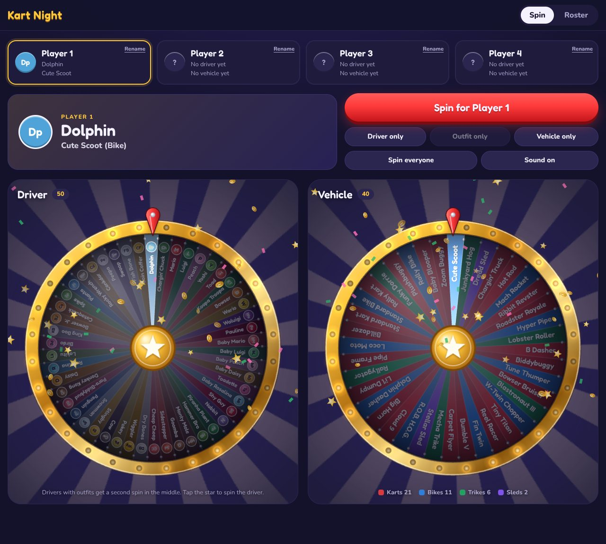

# Kart Night

A family scoreboard for Mario Kart World. Two roulette wheels pick each racer's
driver and vehicle, then the app scores every race and keeps the history for
Mom, Dad, Kid and Player 4, synced across the family's phones and tablets.



## Stack

| Piece | Choice | Why |
| --- | --- | --- |
| Language | TypeScript | Runs in any browser (phone, tablet, laptop, TV browser) with no install, and catches typos in the roster data before they reach the screen. |
| UI | React + Vite | Forms, standings and history screens. Vite gives instant reloads while building. |
| Wheels | PixiJS (WebGL) | GPU-drawn wheels with lighting, glow, motion blur and particles at 60 fps, even on a tablet. |
| Score history | Supabase (Postgres) | Free tier, live sync between devices, simple family sign-in. |
| Hosting | GitHub Pages or Netlify | Builds from this repo on every push. |

## Plan

1. **Foundation** (done): project setup, all 50 drivers, their 103 outfits, 40 vehicles, 8 cups and the 24-racer points table, with tests.
2. **The wheels** (done): a driver wheel (50) and a vehicle wheel (40), drawn in WebGL with motion blur, marquee lights, a flapper that clicks on every peg, sound and a confetti reveal. Drivers with outfits get a second, smaller wheel that pops up over the hub. Every spin uses the browser's crypto random source, so each slice has an equal chance.
3. **Race night**: pick the cup, enter each player's finishing place (1st to 24th), live standings, cup winner celebration.
4. **History and sync**: Supabase database, family sign-in, per-player history (wins, average place, favorite driver, head-to-head).
5. **Ship it**: deploy so it opens from a bookmark on every device.

## Data sources

Roster, vehicles, cups and points come from the Super Mario Wiki and Nintendo's
update notes, current to game version 1.8.0 (September 2026). Characters are drawn as
colored badges instead of official artwork, so the repo carries no Nintendo images.

## Run it

```sh
npm install
npm run dev     # local dev server
npm test        # roster and scoring checks
npm run build   # production build into dist/
```
